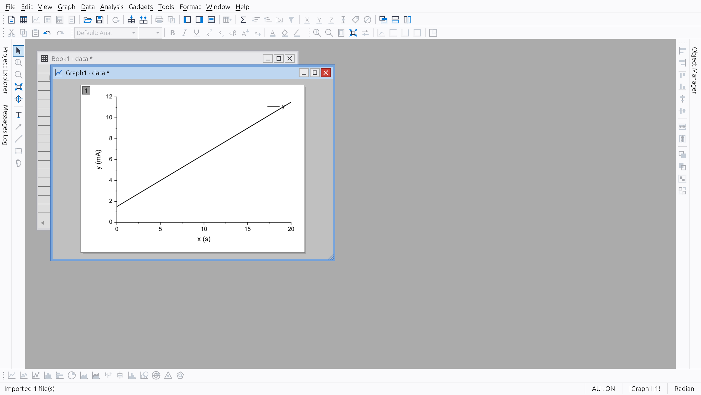

<p align="center">
  
</p>

<h1 align="center">Sheaf</h1>

<p align="center">
  <b>Scientific data analysis and graphing; an open-source, clean-room reimplementation of Origin and OriginPro workflows, rebuilt in Rust.</b><br>
  Workbooks, scientific plots, curve fitting, and data analysis,<br>
  in a native app written in Rust. Runs locally on macOS and Windows.
</p>

<p align="center">
  
  <a href="#macos"></a>
  <a href="#windows"></a>
  <a href="#license-and-credits"></a>
  
</p>

<p align="center">
  <a href="#features">Features</a> ·
  <a href="#platform-support">Platform support</a> ·
  <a href="#get-started">Get started</a> ·
  <a href="#command-line">Command line</a> ·
  <a href="#under-the-hood">Under the hood</a> ·
  <a href="#documentation">Documentation</a> ·
  <a href="#license-and-credits">License and credits</a>
</p>

<br>

<p align="center">
  
  <br>
  <sub>The real desktop app on Apple Silicon macOS, displaying synthetic CSV data.</sub>
</p>

## Features

<table>
  <tr>
    <td width="50%" valign="top">
      <h3>Bring your data</h3>
      Import CH Instruments text and binary files, CSV, and other delimited text into workbooks.
    </td>
    <td width="50%" valign="top">
      <h3>Make your figures</h3>
      Overlay curves, adjust axes and legends, and export PNG, SVG, PDF, EPS, EMF, or TIFF.
    </td>
  </tr>
  <tr>
    <td width="50%" valign="top">
      <h3>Find the signal</h3>
      Integrate, smooth, find peaks, run statistics, and fit linear, polynomial, or nonlinear models.
    </td>
    <td width="50%" valign="top">
      <h3>Keep your workflow</h3>
      Work with Origin project files and familiar workbook and graph controls.
    </td>
  </tr>
</table>

> [!NOTE]
> Early development. Origin/OriginPro feature coverage and Origin `.opj` support are partial.
> Expect rough edges; Sheaf is not yet a complete replacement for Origin or OriginPro.
> See the [roadmap](docs/ROADMAP.md) for current progress.

## Platform support

### Windows

Windows support is confirmed by the project owner. Use the Cargo commands below to build
and run the desktop app and CLI. The Windows desktop binary is `target/release/sheaf-app.exe`;
the CLI binary is `target/release/sheaf.exe`.

### macOS

**Verified locally on Apple Silicon (arm64), macOS 27.0.1, with Rust 1.99.1 on November 12, 2026.**
All 1,081 workspace tests pass, formatting and Clippy checks pass, the desktop app opens and
renders imported data, and the CLI imports,
analyzes, fits, saves, and exports a synthetic CSV dataset. This is a source-build check;
it does not establish a minimum macOS version or verify every interactive workflow.

The [platform check](https://github.com/Electrochemistry-Undergrads/OriginRust/actions/runs/43369106301)
also passed its build, core/CLI tests, and desktop/CLI smoke checks on Apple Silicon and Intel
macOS runners. Its overall run is marked failed because of the Linux reporting step.

Build from source using the commands below. No macOS installer, signing, or notarization is
provided by this repository. Plot text uses installed system fonts, so figures may differ
slightly between machines.

## Get started

Requires [Rust](https://www.rust-lang.org/tools/install) 1.90 or newer.
On macOS, install Apple's Command Line Tools if needed (`xcode-select --install`), then
install Rust through [rustup](https://rustup.rs/). The first build downloads dependencies
and can take several minutes.

```sh
git clone https://github.com/Electrochemistry-Undergrads/OriginRust.git
cd OriginRust
cargo run --release -p sheaf-app
```

Drop a data file onto the window, or open one directly:

```sh
cargo run --release -p sheaf-app -- run1.txt
```

`OriginRust` is the repository name; **Sheaf** is the application name. The desktop binary
is `target/release/sheaf-app`; the CLI binary is `target/release/sheaf` (both have a `.exe`
extension on Windows).

## Command line

```sh
cargo run --release -p sheaf-cli -- import run1.txt -o experiment.sheaf --plot
cargo run --release -p sheaf-cli -- plot run1.txt -o figure.png --dpi 300
cargo run --release -p sheaf-cli -- analyze integrate run1.txt
cargo run --release -p sheaf-cli -- fit run1.txt --model linear
cargo run --release -p sheaf-cli -- --help
```

Saving to `.opj` is supported, with a `.opj.sheaf` companion when the Origin file cannot hold
everything. Keep that companion beside the project. The native `.sheaf` format preserves
the full project model.

## Under the hood

- Eight Rust crates separate the workbook model, expression language, analysis, fitting,
  file formats, figure rendering, CLI, and desktop UI.
- The desktop interface uses egui/eframe with an OpenGL renderer.
- The desktop app and CLI share the same data, analysis, and rendering crates.
- Origin compatibility is implemented from observed behavior and documented formats;
  current gaps are tracked in the [feature parity table](docs/spec/feature-parity.md).

## Documentation

[Roadmap](docs/ROADMAP.md) ·
[Specifications](docs/spec/) ·
[Design decisions](docs/adr/)

Contributors: start with [HANDOFF.md](HANDOFF.md).
Run checks with:

```sh
cargo fmt --all -- --check
cargo clippy --workspace --all-targets -- -D warnings
cargo test --workspace --locked
```

## License and credits

Sheaf is dual-licensed under [MIT](LICENSE-MIT) or [Apache-2.0](LICENSE-APACHE), at your option.
Copyright (c) 2026 Sheaf contributors. Project notices are in [NOTICE](NOTICE).

Third-party dependencies and their bundled fonts retain their own licenses and notices.
The Sheaf logo is in [`docs/brand/sheaf.png`](docs/brand/sheaf.png).

<sub>Origin and OriginPro are products of OriginLab; these names describe compatible workflows and file formats.
Sheaf is an independent project and is not affiliated with, sponsored by, or endorsed by OriginLab.</sub>
